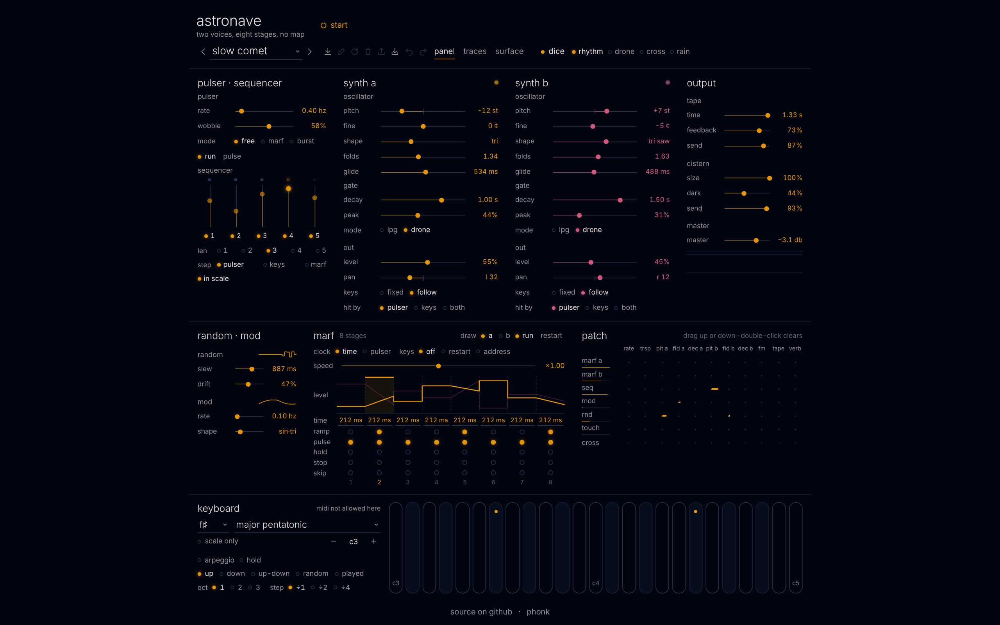
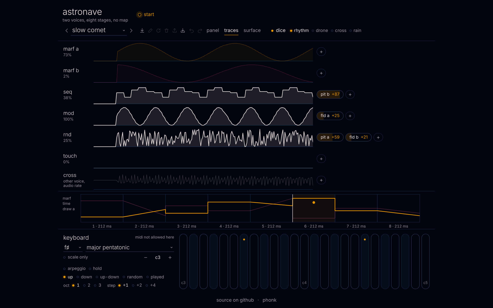
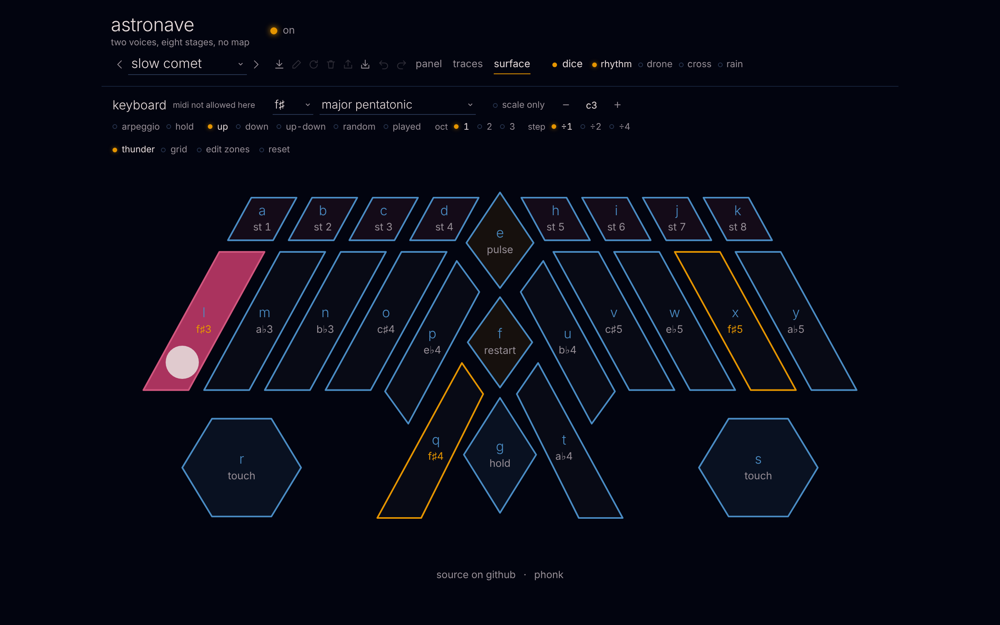

# astronave

*two voices, eight stages, no map*

A two-voice touch synth that runs in your browser, in the spirit of the Buchla Music Easel. Two wavefolding voices that bend each other, a pulser, a five-step sequencer, random and slow modulation, an eight-stage function generator and a patch matrix that connects everything to everything. One HTML file, no samples, no dependencies, no install.

**▶ Play it: [phonk.github.io/astronave](https://phonk.github.io/astronave/)**

**The full [manual](MANUAL.md)** goes through every control, with a few patches to try. It is also in Italian: [manuale](MANUALE.md).

## Play

Tap **start**, then touch the keyboard. The vertical position of your finger on a key is **Touch**: lower is stronger, and Touch is also a modulation source.

**rec** records exactly what comes out, as a 24-bit WAV. Press it again to stop (it shows the time while it runs), then download the file, share it or throw it away. A recording stops by itself at 20 minutes.

Pick a scene from the list at the top, or press **dice** for a random one (rhythm, drone, cross or rain). Save your own scenes with the icons next to the list; a name is suggested for you.

## Three views

**panel**: every control on one screen. Pulser and sequencer, synth A, synth B, output (tape echo and the cistern reverb), then random and mod, the MARF and the patch matrix. It is the picture at the top of this page.

**traces**: one lane per modulation source, with its signal scrolling live. On the right, the places it goes. Drag a tag up or down to set the amount, drag it to zero to cut it, press **+** to send the source somewhere new.

**surface**: a big touch surface made of zones. The **touch** layout has two fans of notes, one per hand, a thin outer arc for the eight MARF stages, a quarter disc under each palm that sends Touch only, and a round control in the middle for pulse, restart and hold. In a fan, the closer to the palm you touch, the stronger the note; a zone lights up more the harder you press. Press **edit zones** to change what a zone does: a note of the scale, a MARF stage, the pulser, restart, Touch only, or hold. There are two more layouts: **thunder**, slanted plates after the Buchla 222e, and a plain grid.

## The parts

- **Synth A and B**: an oscillator that morphs between shapes, a wavefolder and a low pass gate. **bias** pushes the wave off centre before it folds, so the two halves fold differently and the tone fills out. Each can ring as a drone or be struck by the pulser, the keys or both.
- **Pulser**: free running, clocked by the MARF, or in bursts.
- **Sequencer**: five steps that can be switched off one by one, stepped by the pulser, the keys or the MARF, optionally quantised to the scale.
- **MARF**: eight stages with two levels each (A and B), a time, and flags for ramp, pulse, hold, stop and skip. It runs on its own time or on the pulser, and the keys can restart it or address its stages.
- **Patch**: seven sources (MARF A, MARF B, seq, mod, rnd, touch, cross) to thirteen destinations (pulser rate, transpose, pitch, folds, bias and decay of each voice, FM, tape, reverb). Cross is one voice modulating the other at audio rate.
- **Keyboard**: root, scale, octave, an arpeggiator with hold, and the option to show only the notes of the scale. The scales include just intonation, maqam scales with quarter tones, slendro and pelog.

## MIDI

A MIDI keyboard plays it where the browser has Web MIDI: Chrome, Edge or Firefox on a computer or on Android. Safari and iPhone do not have it.

## Notes

- In landscape the whole instrument fits one screen, on a computer or a tablet. On a phone held upright the sections stack and the keys stay at the bottom.
- On a phone it keeps playing with the screen off, and you can stop it from the lock screen. If the phone cuts the sound anyway, one tap on start or on a key brings it back.
- Your scenes are kept in the browser you saved them in. Use export and import to move them.
